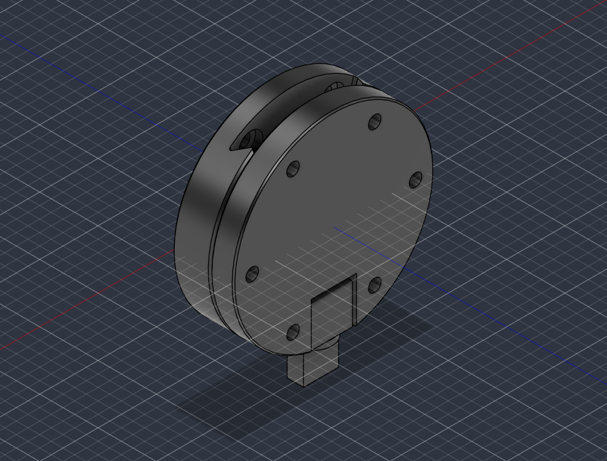

# FFBeast – slide-in Quick Release (V wedge + dovetail)

Status: **printed and working.** A prototype made from the files in this repository is mounted on my wheel and works well in practice.
The strength figures below are still hand estimates, not measurements or FEA results.

## Files

| File | What it is |
|---|---|
| `cad/FFBeast_QR.f3d` | Fusion 360 project (3 components, 74 timeline features, user parameters `qr_*`) |
| `cad/FFBeast_QR.step` | the same as STEP |
| `cad/build_qr.py` | generator script: change the values in the `P` dictionary and run it in Fusion – it rebuilds the whole assembly from scratch |
| `cad/verify_qr.py` | collision and fit check script (read only) |
| `stl/A_base_QR.stl` | part A, already oriented for printing |
| `stl/B_wheel_adapter.stl` | part B, already oriented for printing (upside down, wheel side on the bed) |
| `stl/C_locking_screw.stl` | locking screw, already oriented for printing (lying down) |
| `img/*.png` | views from Fusion |

A note on parameters: the `qr_*` parameters in Fusion are a list of values, while the sketches are computed by the script.
To change a dimension, edit `P` in `build_qr.py` and run the script again (about 20 s) – that is the real parametric source.

## 1. Analysis of the existing STL files

The folder had three files. They all share the same interface: **6 holes on a Ø70.00 mm circle, 60° apart**.

| File | Size | Holes on Ø70 | Other features |
|---|---|---|---|
| `flange_a.stl` | Ø85 (Ø88 collar) × 30.4 mm | 12 × Ø6.27 every 30° (two sets of 6) | nut slots 8.3 × 4.3 mm (fit M5), 4.5 mm below the face; centre bore Ø35 / Ø50; 4 × Ø3 on Ø42 |
| `flange_b.stl` | Ø83 × 76 mm | 15 mm base: 12 × Ø7; 6 mm top collar: 6 × Ø5 | sleeve Ø60 / Ø50 |
| `drilling_template.stl` | Ø80 × 11 mm | 6 × Ø5 + Ø5 in the centre | drilling template |

What the STL files **don't** tell you and what you need to check – see "Check before printing for your wheel" at the end.

## 2. Chosen design

- **Part A (base)** – a Ø86 × 16 mm disc screwed to the flange with 6 screws. It has a V-shaped channel with undercut walls and a tower with the locking screw.
- **Part B (wheel adapter)** – a Ø86 × 10 mm disc with a V-shaped tongue that fits the channel; screwed to the wheel with the wheel's existing screws.
- **Part C (locking screw)** – printed, trapezoidal thread with a 3 mm pitch. It pulls the tongue into the wedge and holds it there.

The wheel sits **26 mm** further out from the flange.

How it works:
1. The channel narrows in plan view (14° half-angle). The tongue slides in until it touches **both** walls at once – side and rotational play disappear regardless of print accuracy.
2. The walls are undercut by 35° (dovetail), so pushing the wedge in also pulls plate B down onto A – axial play disappears.
3. The screw pulls the tongue deeper into the wedge and is the only thing that stops it from backing out. The 14° wedge is **not self-locking** – on purpose: a small angle would be self-locking, but every 0.1 mm of print error would move the wheel off-axis by about 2 mm.

### Geometries considered

| Geometry | Play | Verdict |
|---|---|---|
| Parallel dovetail | print play always remains (0.1–0.2 mm) | rejected |
| Dovetail with a clamping strip | zero, but several screws to adjust | rejected – too many parts |
| Flat wedge without undercut | zero in plan, but nothing holds it axially | rejected |
| Small-angle wedge (3–5°) | zero, self-locking | rejected – axis position too sensitive to print tolerance |
| **14° V wedge + 35° undercut** | zero in three directions, repeatable position (0.1 mm error → 0.4 mm along Y) | **chosen** |

### Lock – why a screw and why from the side

- A screw through the centre, on the wheel axis, can't be reached: the wheel blocks it from the front and the motor from the back.
- A latch or a lever was ruled out; a lock without adjustment can't take up wear.
- So the screw runs **in the slide-in direction**, through the middle of the mechanism, and the knob sticks out radially from the base.
- It is fully printed. It has a neck and a short thread in the tower, so once unscrewed it **does not fall out** of the base.
- No metal screw is needed for the lock. It is, however, the weakest part of the assembly (see section 6).

## 3. What you need to buy

This can't be avoided with two parts: the existing 6 screws hold the wheel, and the base also has to be screwed to something.

| Qty | Item | Used for |
|---|---|---|
| 6 | **M5 × 16 button head screw, ISO 7380** | part A → flange (go into the flange's existing nuts) |
| 6 | M5 nut (DIN 934) | pockets in part B |

The button head is required for the two holes that sit in the channel floor (only 4.8 mm of material under the head). A regular M5 socket head won't fit there.

## 4. Assembly

**Part A**
1. Remove the wheel. The nuts stay in the flange.
2. Put A flat side against the flange, tower **down**.
3. Insert the 6 M5 × 16 screws and tighten them lightly in a cross pattern. Align A with the flange rim all the way round, then tighten. Don't overtighten – it's PETG.
4. Screw C into the tower until the thread passes the short entry thread and the screw slides freely.

**Part B**
1. Put the 6 M5 nuts into the pockets (tongue side).
2. Put the smooth side of B against the back of the wheel.
3. Screw it on with the wheel's existing screws. **The screw ends must not stick out above the pocket face** – otherwise B won't slide onto A. Screws may stick out of the back of the wheel by 8–10 mm. If they stick out more, add washers under the heads or use shorter screws.

**Mounting the wheel**
1. Back screw C out all the way (about 3.5 turns).
2. Hold the wheel about 15 mm above its final position – the tongue drops into the wide part of the channel.
3. Slide it down until it stops.
4. Tighten screw C by hand until you feel clear resistance.

**Removing:** loosen C until it no longer holds, slide the wheel up about 15 mm, pull it towards you.

## 5. Print settings (Ender 3 V3, 0.4 nozzle)

| | A – base | B – adapter | C – screw |
|---|---|---|---|
| Material | PETG | PETG | PETG |
| Orientation | as in the STL: flat side on the bed | as in the STL: wheel side on the bed, tongue up | as in the STL: lying down, on the cut flat |
| Layer | 0.20 mm | 0.20 mm | 0.12–0.16 mm |
| Walls | 6 | 6 | 6 |
| Top / bottom | 6 / 6 | 6 / 6 | – |
| Infill | 60 % gyroid | 60 % gyroid | 100 % |
| Supports | none | none | none; 5 mm brim |
| Filament (est.) | about 75–80 g | about 68–72 g | about 5 g |
| Time (est.) | about 3–3.5 h | about 3 h | about 25 min |

- 240–250 °C, bed 80 °C, cooling 30–50 % – layer bonding matters more than looks.
- Time and weight are estimated from the volume (A 69.1 cm³, B 61.6 cm³, C 3.6 cm³); your slicer will give exact values.
- Don't use PLA: it creeps under the constant load of the wedge and softens at about 55 °C. TPU isn't needed here.
- Screw C must be printed lying down. Printed upright, the layers would be across the pulling direction and the neck would snap.

Layer direction: in A and B the layers are perpendicular to the wheel axis. Torque runs along the layers (the strong direction). Pulling the wheel off the base loads the tongue layers across (the weak direction) – that's why the tongue neck has a cross-section of about 1300 mm².

## 6. Load estimate and failure points

Assumptions: 15 N·m of torque, 150 N on the rim at a 150 mm radius (22.5 N·m of bending).

| Location | Estimate | Notes |
|---|---|---|
| Wedge walls – torque | about 1.5–2 MPa contact pressure | large margin |
| Tongue neck – pull-off (across layers) | about 1.5–2 MPa | PETG between layers holds 15–25 MPa statically; depends on print quality |
| Wedge walls – pull-off | about 3–4 MPa contact pressure | the 35° undercut multiplies the force by about 1.7× |
| **Screw C – Ø7.5 core (44 mm²)** | about 11 MPa at 500 N | **weakest part**; static margin about 3–4×, less for fatigue and creep |
| Screw thread (3 turns engaged) | about 4–5 MPa | – |
| Under the A screw heads in the channel floor (4.8 mm) | – | don't overtighten |

What happens if something fails:
- **Screw C snaps or comes loose** → the wheel can slide up by 15 mm and then come off the base. Nothing but the screw holds it then.
- **Tongue B delaminates** → the wheel comes off together with the plate.
- **PETG creep** → after a few days the screw will be looser; it needs retightening.
- **Wedge wall wear** → the tongue seats deeper; there's 3 mm of reserve, after that the tongue hits the end wall and play appears.

If screw C turns out too weak, a sensible fix is a metal M5/M6 screw with a nut in the tongue – this needs a model change.

## 7. What was checked in CAD

Checked with `verify_qr.py` on the finished model:
- each part is a single closed solid, the timeline has no errors, the STL files are watertight;
- A–B, A–C, B–C collision in the nominal position: **0 mm³**;
- the tongue seats 0.4 mm past the nominal position (as expected with 0.10 mm clearance per side);
- in the closed position, a 0.5° rotation or a 0.3 mm side shift causes a collision – the joint is form-locked;
- lifting B along the axis collides at 0–12 mm of slide-out and is free from 14 mm;
- the Tr11×3 screw turns in the Tr12×3 thread without collision within ±20° (about 0.3 mm axial play – intentional, for printing).

After printing: fit and function confirmed on the prototype. Strength and stiffness were not measured – the figures in section 6 are estimates.

## 8. Tests after printing

The prototype passed real-world use. If you print your own (different printer, different filament), go through these steps – print tolerances differ between printers.

1. **Dry fit, no motor.** Slide B into A by hand. Measure the gap between the tongue front and the tower wall: it should be 2–3 mm. Below 1 mm → increase `fit_clr` by 0.05–0.10 and reprint B. Above 4 mm → decrease it.
2. **Screw.** It must turn by hand along its whole length. If it binds, scale C in the slicer to 97–98 % in X and Z.
3. **Play by hand, motor off.** Tighten C and try to move the wheel rotationally, sideways and towards you. There should be no noticeable movement or knocking.
4. **Static test, motor off.** Load the rim with about 5 kg in several directions; check the tongue root and the tower for white stress marks.
5. **FFB 10–20 %**, 10 minutes, gentle moves. Then remove the wheel and inspect the wedge walls, the screw and the gap from step 1.
6. **Increase force gradually** (30 → 50 → 70 %), inspecting after each step and checking that the screw hasn't loosened.
7. **Full force only after a few hours without changes.** For the first weeks, retighten the screw before each session.

During powered tests keep your fingers away from the mechanism and the knob. Stop the test if you hear a knock, feel play, see a white stress mark, or the screw can be tightened noticeably further than before.

## Check before printing for your wheel

1. **Flange** – the design fits `flange_a` and `flange_b` (same 6-hole pattern on Ø70).
2. **The wheel screws are M5.** If yours are M6, change `a_hole_d`, `a_cbore_d`, `b_hole_d`, `b_nut_af` in `build_qr.py`.
3. **The screws stick out of the back of the wheel by 8–10 mm at most.**
4. **The back of the wheel is flat across 86 mm** and nothing sticks out of the centre.
